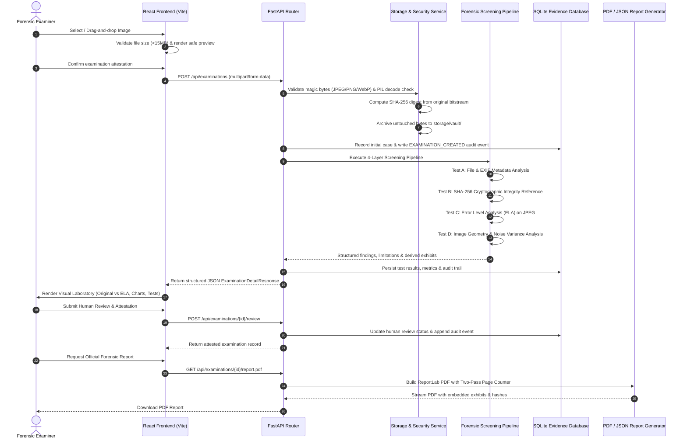

# SCSS SATYA — System Architecture & Component Design

## 1. Guiding Doctrine
> **"The tool screens. The expert decides."**  
> Automated findings are never presented as conclusive forensic opinions, legal proof, or definitive proof that an image is authentic or manipulated.

---

## 2. 4-Layer Forensic Architecture

```
┌─────────────────────────────────────────────────────────────────────────────┐
│                           SCSS SATYA ARCHITECTURE                           │
├─────────────────────────────────────────────────────────────────────────────┤
│  Layer 1: Passive-Blind Non-Invasive Manipulation Screening                │
│           • EXIF / XMP / IPTC metadata inspection (Test A)                 │
│           • Error Level Analysis (ELA) with amplified residual map (Test C) │
│           • Image geometry & spatial high-frequency noise variance (Test D) │
│                                                                             │
│  Layer 2: Tamper-Evident Evidence Integrity Record                         │
│           • SHA-256 cryptographic bitstream hashing (Test B)                │
│           • Non-invasive raw byte storage in isolated vault                │
│           • On-demand bitstream re-verification endpoint                    │
│                                                                             │
│  Layer 3: Explainable Technical Findings & Limitations                      │
│           • Multi-indicator checklist (No Indicator / Indicator / Inconcl.)│
│           • Mandatory scientific limitations declaration                    │
│           • Suggested manual verification checklist for examiners           │
│                                                                             │
│  Layer 4: Qualified Human Forensic Review & Legal Certification             │
│           • Certified examiner credentials & formal qualitative notes       │
│           • Formal opinion attestation checkbox                             │
│           • Downloadable ISO/IEC 27037 PDF & machine-readable JSON reports  │
└─────────────────────────────────────────────────────────────────────────────┘
```

---

## 3. Component Interaction & Data Flow



---

## 4. Storage Architecture

| Directory | Purpose | Security Policy |
|---|---|---|
| `storage/vault/` | Stores untouched original uploaded evidence bytes | Read-only working copy; never edited in place |
| `storage/artifacts/` | Stores derived visual exhibits (ELA heatmaps, noise maps) | Derived inspection outputs; clearly labelled as non-original |
| `storage/reports/` | Stores generated ISO/IEC 27037 PDF reports | Generated on-demand or cached for download |
| `storage/satya_forensics.db` | Relational SQLite database | Indexed by `examination_id` and `sha256_digest` |

---

## 5. Technology Stack Summary

- **Frontend**: React 19, TypeScript, Vite, Tailwind CSS v4, Lucide React, Recharts, React Router v7.
- **Backend**: Python 3.11, FastAPI, Pydantic v2, Pillow, OpenCV (headless), ReportLab, ExifRead, SQLite, SQLAlchemy.
- **Testing**: pytest, FastAPI TestClient (httpx), synthetic image generation scripts.
